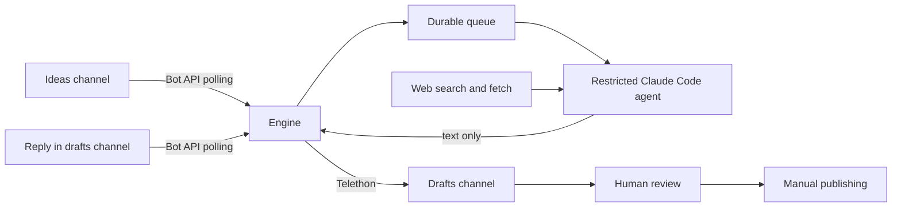

# AI Content Factory

Drop a one-line idea into a private Telegram channel. An AI agent researches it, writes a post in your style and sends the draft to a second channel for your review. Nothing is published without a person approving it.

This repository is a clean rewrite of a system I built earlier, with a stronger security design.

> **Status: portfolio example.** The code is covered by offline tests, but this rewrite has not been run against live Telegram and Claude services. Production prompts and personal data are not included.

**Built with:** Python, Telegram Bot API, Telethon, Claude Code, pytest

## Results from the original system

- 100+ social media posts generated
- Style learned from 200 past posts
- About 5 seconds to pick up an idea and 1–3 minutes to a finished draft

## How it works



Reactions show progress on the original message: 👀 queued, 👍 draft sent, 😢 failed.

To change a draft, reply to it with a request. If you quote part of the draft, the request applies to that part.

## Engineering decisions

| Decision | Why |
|---|---|
| The agent gets only web search and web fetch | Ideas and web pages are untrusted. With no shell, file tools or credentials, a prompt injection has little to act on |
| The engine sends the draft, not the agent | Telegram credentials stay outside the model's reach |
| Only configured channels are accepted | Messages from anywhere else are ignored |
| A person approves every post | A model can state something false with confidence, so it never publishes directly |
| Bot API for watching, Telethon for sending | Polling with a bot is simple and needs no user session, but only a user account can send Premium custom emoji |
| Offsets are calculated in UTF-16 units | Telegram counts this way, while Python counts code points. Without conversion, formatting shifts after any emoji |
| State is saved with an atomic rename | A crash cannot corrupt the state file, and queued or interrupted work resumes after a restart |
| Tasks run one at a time | Output order stays predictable and usage stays within limits |
| Network errors hide the request URL | The bot token is part of that URL, so it must never reach the logs |

## Project structure

```text
src/content_factory/
  engine.py        polling loop, queue and task lifecycle
  agent.py         restricted agent process and prompt rendering
  tasks.py         turns Telegram updates into work items
  formatting.py    markup parsing and UTF-16 offsets
  publisher.py     sends drafts through Telethon
  telegram_api.py  Bot API client
  state.py         durable state
  config.py        settings from the environment
tests/             unit tests with fake Telegram and agent services
prompts.example/   generic templates
```

## Running it

These are the intended setup steps. They have not been tested end to end on this rewrite. You need Python 3.10+, the [Claude Code CLI](https://claude.com/claude-code), a Telegram bot added as an admin to two private channels, and Telegram API credentials from my.telegram.org.

```bash
python -m venv .venv && source .venv/bin/activate
pip install -e ".[dev]"
cp .env.example .env              # fill in your values
mkdir -p private
cp -R prompts.example private/prompts
python -m content_factory login   # asks for your Telegram login in this terminal
python -m content_factory run
```

To export your channel's posts for your own style analysis:

```bash
python -m content_factory export-posts your_channel --limit 200
```

## Tests

```bash
pytest
```

The tests run offline. They cover UTF-16 offsets, update routing, queue order, failure handling, restart recovery, agent timeouts and token handling. The real Telegram and Claude connections are not part of the automated tests.

## What is not included

My production prompts, style rules, post history and setup materials are private. `prompts.example/` contains generic templates, so output quality here depends on the style rules you add.

Voice-note revisions, image attachments and auto-start from the original system are not part of this rewrite.

## How I used AI

I built this with Claude Code as my development tool. I owned the requirements, architecture, review and deployment decisions.

## Licence

All rights reserved. See [LICENSE](LICENSE). The code is published for viewing and evaluation.
